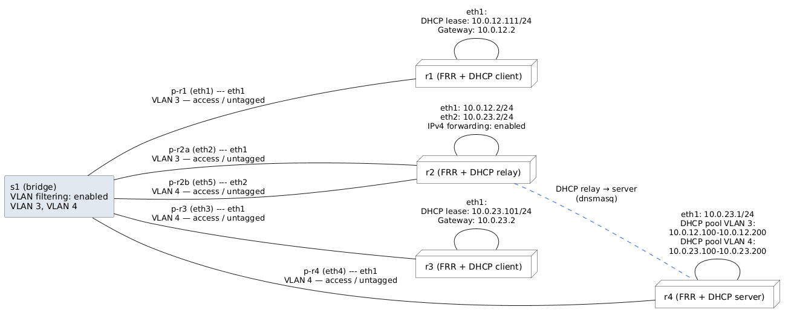

## Топология



## Выполение 

### Предварительная настройка

Сбор образа
```bash
docker build -t lab2-frr-dhcp:latest .
```

```bash
sudo ip link add s1 type bridge vlan_filtering 1
sudo ip link set s1 up
```

```bash
# VLAN 3
sudo bridge vlan add dev eth1 vid 3 pvid untagged
sudo bridge vlan add dev eth2 vid 3 pvid untagged

# VLAN 4
sudo bridge vlan add dev eth3 vid 4 pvid untagged
sudo bridge vlan add dev eth4 vid 4 pvid untagged
sudo bridge vlan add dev eth5 vid 4 pvid untagged

for port in eth1 eth2 eth3 eth4 eth5; do
    sudo bridge vlan del dev "$port" vid 1
done
```

Поскольку FRR не имеет dhcp, используем стороннее ПО: dnsmasq

### Настройка DHCP-сервера

./r4/dnsmasq-server.conf

```text
port=0
no-resolv
interface=eth1
bind-dynamic
dhcp-authoritative
log-dhcp
dhcp-leasefile=/tmp/dnsmasq.leases

# VLAN 3
dhcp-range=set:vlan3,10.0.12.100,10.0.12.200,255.255.255.0,24h
dhcp-option=tag:vlan3,option:router,10.0.12.2

# VLAN 4
dhcp-range=set:vlan4,10.0.23.100,10.0.23.200,255.255.255.0,24h
dhcp-option=tag:vlan4,option:router,10.0.23.2
```

Запуск:

```bash
docker exec -d clab-lab2-r4 dnsmasq \
  --no-daemon \
  --conf-file=/etc/dnsmasq-server.conf
```
3) Настройка DHCP-relay

```text
port=0
no-resolv
log-dhcp
dhcp-relay=10.0.12.2,10.0.23.1
```

Запуск:

```bash
docker exec -d clab-lab2-r2 dnsmasq \
  --no-daemon \
  --conf-file=/etc/dnsmasq-relay.conf
```
4) Настройка клиентов


r3:

```bash
docker exec -it clab-lab2-r3 udhcpc -i eth1 -f -v
udhcpc: started, v1.37.0
udhcpc: broadcasting discover
udhcpc: broadcasting discover
udhcpc: broadcasting select for 10.0.23.101, server 10.0.23.1
udhcpc: broadcasting select for 10.0.23.101, server 10.0.23.1
udhcpc: lease of 10.0.23.101 obtained from 10.0.23.1, lease time 86400
```

r1:

```bash
docker exec -it clab-lab2-r1 udhcpc -i eth1 -f -v
udhcpc: started, v1.37.0
udhcpc: broadcasting discover
udhcpc: broadcasting select for 10.0.12.111, server 10.0.23.1
udhcpc: lease of 10.0.12.111 obtained from 10.0.23.1, lease time 86400
```


Проверка:

```bash
docker exec clab-lab2-r1 ping -c 4 10.0.12.2
docker exec clab-lab2-r1 ping -c 4 10.0.23.2
docker exec clab-lab2-r1 ping -c 4 10.0.23.101
PING 10.0.12.2 (10.0.12.2): 56 data bytes
64 bytes from 10.0.12.2: seq=0 ttl=64 time=0.055 ms
64 bytes from 10.0.12.2: seq=1 ttl=64 time=0.101 ms
64 bytes from 10.0.12.2: seq=2 ttl=64 time=0.116 ms
64 bytes from 10.0.12.2: seq=3 ttl=64 time=0.101 ms

--- 10.0.12.2 ping statistics ---
4 packets transmitted, 4 packets received, 0% packet loss
round-trip min/avg/max = 0.055/0.093/0.116 ms
PING 10.0.23.2 (10.0.23.2): 56 data bytes
64 bytes from 10.0.23.2: seq=0 ttl=64 time=0.053 ms
64 bytes from 10.0.23.2: seq=1 ttl=64 time=0.075 ms
64 bytes from 10.0.23.2: seq=2 ttl=64 time=0.099 ms
64 bytes from 10.0.23.2: seq=3 ttl=64 time=0.096 ms

--- 10.0.23.2 ping statistics ---
4 packets transmitted, 4 packets received, 0% packet loss
round-trip min/avg/max = 0.053/0.080/0.099 ms
PING 10.0.23.101 (10.0.23.101): 56 data bytes
64 bytes from 10.0.23.101: seq=0 ttl=63 time=0.123 ms
64 bytes from 10.0.23.101: seq=1 ttl=63 time=0.097 ms
64 bytes from 10.0.23.101: seq=2 ttl=63 time=0.087 ms
64 bytes from 10.0.23.101: seq=3 ttl=63 time=0.109 ms

--- 10.0.23.101 ping statistics ---
4 packets transmitted, 4 packets received, 0% packet loss
round-trip min/avg/max = 0.087/0.104/0.123 ms
```

## Полезные ссылки

- [github репозиторий со всеми лабами](https://google.com)
- [Container lab - используемая инфраструктура](https://containerlab.dev/)
- [FRR - используемый роутер](https://frrouting.org/)

