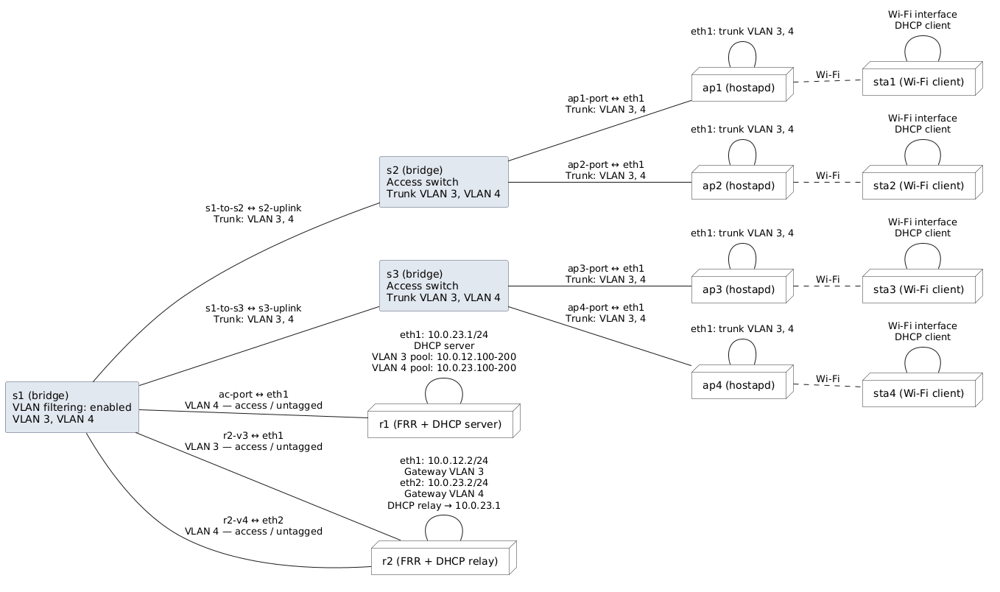

# Создание WLAN

## Топология



## Выполение 

### Предварительная настройка

Сбор образов
```bash
docker build -t lab6-frr-dhcp:latest .
docker build -t lab6-wifi:latest -f Dockerfile.wifi .
```

Создание мостов

```bash
sudo ip link add s1 type bridge vlan_filtering 1
sudo ip link set s1 up
sudo ip link add s2 type bridge vlan_filtering 1
sudo ip link set s2 up
sudo ip link add s3 type bridge vlan_filtering 1
sudo ip link set s3 up
```

```bash
sudo containerlab deploy --topo lab6/topology.clab.yml
```

```bash
for port in ac-port r2-v3 r2-v4 \
            s1-to-s2 s2-uplink s1-to-s3 s3-uplink; do
    sudo bridge vlan del dev "$port" vid 1 2>/dev/null || true
done

sudo bridge vlan add dev ac-port vid 4 pvid untagged
sudo bridge vlan add dev r2-v3 vid 3 pvid untagged
sudo bridge vlan add dev r2-v4 vid 4 pvid untagged

for port in s1-to-s2 s2-uplink s1-to-s3 s3-uplink; do
    sudo bridge vlan add dev "$port" vid 3
    sudo bridge vlan add dev "$port" vid 4
done
```

```bash
for port in ap1-port ap2-port; do
    sudo bridge vlan del dev "$port" vid 1 2>/dev/null || true
    sudo bridge vlan add dev "$port" vid 3
    sudo bridge vlan add dev "$port" vid 4
done

for port in ap3-port ap4-port; do
    sudo bridge vlan del dev "$port" vid 1 2>/dev/null || true
    sudo bridge vlan add dev "$port" vid 3
    sudo bridge vlan add dev "$port" vid 4
done
```

Поскольку FRR не имеет dhcp, используем стороннее ПО: dnsmasq

### Настройка DHCP-сервера

./r1/dnsmasq-server.conf

```text
port=0
no-resolv
interface=eth1
bind-dynamic
dhcp-authoritative
log-dhcp
dhcp-leasefile=/tmp/dnsmasq.leases

# VLAN 3
dhcp-range=set:vlan3,10.0.12.100,10.0.12.200,255.255.255.0,24h
dhcp-option=tag:vlan3,option:router,10.0.12.2

# VLAN 4
dhcp-range=set:vlan4,10.0.23.100,10.0.23.200,255.255.255.0,24h
dhcp-option=tag:vlan4,option:router,10.0.23.2
```

Запуск:

```bash
docker exec -d clab-lab6-r1 dnsmasq \
  --no-daemon \
  --conf-file=/etc/dnsmasq-server.conf
```
### Настройка DHCP-relay

```text
port=0
no-resolv
log-dhcp
dhcp-relay=10.0.12.2,10.0.23.1
```

Запуск:

```bash
docker exec -d clab-lab6-r2 dnsmasq \
  --no-daemon \
  --conf-file=/etc/dnsmasq-relay.conf
```

### Настройка клиентов

Создание беспроводных клиентов

mac80211_hwsim - модуль ядра Linux, предназначенный для программной эмуляции беспроводных адаптеров Wi-Fi

```bash
sudo modprobe mac80211_hwsim radios=8
```

iw - утилита для работы с беспроводными сетями

```bash
iw dev
phy#8
        Interface wlan7
                ifindex 55
                wdev 0x800000001
                addr 5a:e4:ca:17:39:2a
                type managed
                txpower 20.00 dBm
                multicast TXQ:
                        qsz-byt qsz-pkt flows   drops   marks   overlmt hashcol tx-bytes        tx-packets
                        0       0       0       0       0       0       0       0               0
phy#7
        Interface wlan6
                ifindex 54
                wdev 0x700000001
                addr 72:23:40:7a:68:05
                type managed
                txpower 20.00 dBm
                multicast TXQ:
                        qsz-byt qsz-pkt flows   drops   marks   overlmt hashcol tx-bytes        tx-packets
                        0       0       0       0       0       0       0       0               0
phy#6
        Interface wlan5
                ifindex 53
                wdev 0x600000001
                addr ee:d1:f1:6c:28:77
                type managed
                txpower 20.00 dBm
                multicast TXQ:
                        qsz-byt qsz-pkt flows   drops   marks   overlmt hashcol tx-bytes        tx-packets
                        0       0       0       0       0       0       0       0               0
phy#5
        Interface wlan4
                ifindex 52
                wdev 0x500000001
                addr c2:b4:e3:7b:2e:53
                type managed
                txpower 20.00 dBm
                multicast TXQ:
                        qsz-byt qsz-pkt flows   drops   marks   overlmt hashcol tx-bytes        tx-packets
                        0       0       0       0       0       0       0       0               0
phy#4
        Interface wlan3
                ifindex 51
                wdev 0x400000001
                addr 5a:80:16:28:bb:39
                type managed
                txpower 20.00 dBm
                multicast TXQ:
                        qsz-byt qsz-pkt flows   drops   marks   overlmt hashcol tx-bytes        tx-packets
                        0       0       0       0       0       0       0       0               0
phy#3
        Interface wlan2
                ifindex 50
                wdev 0x300000001
                addr ae:7f:18:47:ae:78
                type managed
                txpower 20.00 dBm
                multicast TXQ:
                        qsz-byt qsz-pkt flows   drops   marks   overlmt hashcol tx-bytes        tx-packets
                        0       0       0       0       0       0       0       0               0
phy#2
        Interface wlan1
                ifindex 49
                wdev 0x200000001
                addr ea:67:19:4d:64:0c
                type managed
                txpower 20.00 dBm
                multicast TXQ:
                        qsz-byt qsz-pkt flows   drops   marks   overlmt hashcol tx-bytes        tx-packets
                        0       0       0       0       0       0       0       0               0
phy#1
        Unnamed/non-netdev interface
                wdev 0x100000002
                addr 02:00:00:00:00:00
                type P2P-device
                txpower 20.00 dBm
        Interface wlan0
                ifindex 48
                wdev 0x100000001
                addr 3a:e2:fb:2d:7e:e8
                type managed
                txpower 20.00 dBm
                multicast TXQ:
                        qsz-byt qsz-pkt flows   drops   marks   overlmt hashcol tx-bytes        tx-packets
                        0       0       0       0       0       0       0       0               0
phy#0
        Interface wlp1s0
                ifindex 2
                wdev 0x1
                addr 84:3e:1d:b1:f5:9f
                type managed
                channel 4 (2427 MHz), width: 40 MHz, center1: 2437 MHz
                txpower 20.00 dBm
                multicast TXQ:
                        qsz-byt qsz-pkt flows   drops   marks   overlmt hashcol tx-bytes        tx-packets
                        0       0       0       0       0       0       0       0               0
```

Перенаправление интерфейсов созданных устройств:

```bash
move_phy() {
    local phy="$1"
    local node="$2"
    local pid

    pid=$(docker inspect -f '{{.State.Pid}}' "clab-lab6-${node}" 2>/dev/null) || {
        echo "Не удалось получить PID clab-lab6-${node}" >&2
        return 1
    }

    case "$pid" in
        ''|0|*[!0-9]*)
            echo "Контейнер ${node} не запущен: PID=$pid" >&2
            return 1
            ;;
    esac

    echo "Перенос $phy -> $node (PID $pid)"
    sudo iw phy "$phy" set netns "$pid" || return 1
}

move_iface_phy() {
    local iface="$1"
    local node="$2"
    local phy_path
    local phy

    phy_path=$(readlink -f "/sys/class/net/${iface}/phy80211") || {
        echo "Не удалось определить phy для ${iface}" >&2
        return 1
    }

    phy="${phy_path##*/}"

    move_phy "$phy" "$node"
}

move_iface_phy wlan0 ap1  &&
move_iface_phy wlan1 ap2  &&
move_iface_phy wlan2 ap3  &&
move_iface_phy wlan3 ap4  &&
move_iface_phy wlan4 sta1 &&
move_iface_phy wlan5 sta2 &&
move_iface_phy wlan6 sta3 &&
move_iface_phy wlan7 sta4
```

```bash
for node in ap1 ap2 ap3 ap4 sta1 sta2 sta3 sta4; do
    echo "========== $node =========="
    docker exec "clab-lab6-$node" iw dev
done
========== ap1 ==========
phy#25
        Interface wlan0
                ifindex 106
                wdev 0x1900000001
                addr fe:97:09:83:91:aa
                type managed
                txpower 20.00 dBm
                multicast TXQ:
                        qsz-byt qsz-pkt flows   drops   marks   overlmt hashcol tx-bytes        tx-packets
                        0       0       0       0       0       0       0       0               0
        Unnamed/non-netdev interface
                wdev 0x1900000002
                addr 02:00:00:00:00:00
                type P2P-device
                txpower 20.00 dBm
========== ap2 ==========
phy#26
        Interface wlan1
                ifindex 107
                wdev 0x1a00000001
                addr 66:86:2f:60:72:92
                type managed
                txpower 20.00 dBm
                multicast TXQ:
                        qsz-byt qsz-pkt flows   drops   marks   overlmt hashcol tx-bytes        tx-packets
                        0       0       0       0       0       0       0       0               0
========== ap3 ==========
phy#27
        Interface wlan2
                ifindex 108
                wdev 0x1b00000001
                addr 56:73:ec:ec:be:ae
                type managed
                txpower 20.00 dBm
                multicast TXQ:
                        qsz-byt qsz-pkt flows   drops   marks   overlmt hashcol tx-bytes        tx-packets
                        0       0       0       0       0       0       0       0               0
========== ap4 ==========
phy#28
        Interface wlan3
                ifindex 109
                wdev 0x1c00000001
                addr 02:60:87:3c:d0:1b
                type managed
                txpower 20.00 dBm
                multicast TXQ:
                        qsz-byt qsz-pkt flows   drops   marks   overlmt hashcol tx-bytes        tx-packets
                        0       0       0       0       0       0       0       0               0
========== sta1 ==========
phy#29
        Interface wlan4
                ifindex 110
                wdev 0x1d00000001
                addr 2a:25:69:42:ba:15
                type managed
                txpower 20.00 dBm
                multicast TXQ:
                        qsz-byt qsz-pkt flows   drops   marks   overlmt hashcol tx-bytes        tx-packets
                        0       0       0       0       0       0       0       0               0
========== sta2 ==========
phy#30
        Interface wlan5
                ifindex 111
                wdev 0x1e00000001
                addr de:64:91:00:c6:e5
                type managed
                txpower 20.00 dBm
                multicast TXQ:
                        qsz-byt qsz-pkt flows   drops   marks   overlmt hashcol tx-bytes        tx-packets
                        0       0       0       0       0       0       0       0               0
========== sta3 ==========
phy#31
        Interface wlan6
                ifindex 112
                wdev 0x1f00000001
                addr c2:13:f0:8d:84:00
                type managed
                txpower 20.00 dBm
                multicast TXQ:
                        qsz-byt qsz-pkt flows   drops   marks   overlmt hashcol tx-bytes        tx-packets
                        0       0       0       0       0       0       0       0               0
========== sta4 ==========
phy#32
        Interface wlan7
                ifindex 113
                wdev 0x2000000001
                addr 3e:22:8b:d1:4b:4f
                type managed
                txpower 20.00 dBm
                multicast TXQ:
                        qsz-byt qsz-pkt flows   drops   marks   overlmt hashcol tx-bytes        tx-packets
                        0       0       0       0       0       0       0       0               0
```


### Конфигурирование AP

```bash
configure_ap() {
    local node="$1"
    local wlan="$2"
    local vlan="$3"
    local container="clab-lab6-${node}"

    echo "========== ${node}: VLAN ${vlan} =========="

    docker exec "$container" sh -c "
        set -e

        ip link set eth1 up

        ip link show eth1.${vlan} >/dev/null 2>&1 ||
            ip link add link eth1 name eth1.${vlan} type vlan id ${vlan}

        ip link show br${vlan} >/dev/null 2>&1 ||
            ip link add br${vlan} type bridge

        ip link set br${vlan} up
        ip link set eth1.${vlan} up
        ip link set eth1.${vlan} master br${vlan}

        ip link set ${wlan} down

        hostapd -B \
            -f /tmp/hostapd.log \
            /etc/hostapd/hostapd.conf
    " || return 1

    docker exec "$container" tail -n 5 /tmp/hostapd.log
}

configure_ap ap1 wlan0 3 &&
configure_ap ap2 wlan1 4 &&
configure_ap ap3 wlan2 3 &&
configure_ap ap4 wlan3 4
```
Пример конфигурации hostapd (утилита, делающаябеспроводной сетевой адаптер компьютера в точку доступа Wi-Fi)

```text
interface=wlan0
driver=nl80211
bridge=br3

ssid=LAB6-TEST
hw_mode=g
channel=1
ieee80211n=1
wmm_enabled=1

auth_algs=1
wpa=2
wpa_key_mgmt=WPA-PSK
rsn_pairwise=CCMP
wpa_passphrase=Lab6Test2026
```

### Конфигурирование STA 

Wpa_supplicant — это программное обеспечение, используемое для аутентификации в сетях Wi-Fi на основе протоколов WPA

```bash
configure_sta() {
    local node="$1"
    local wlan="$2"
    local container="clab-lab6-${node}"

    echo "========== ${node} (${wlan}) =========="

    docker exec "$container" sh -c "
        set -e
        mkdir -p /var/run/wpa_supplicant
        ip link set ${wlan} up

        wpa_supplicant -B \
            -i ${wlan} \
            -c /etc/wpa_supplicant/wpa_supplicant.conf \
            -D nl80211 \
            -f /tmp/wpa_supplicant.log
    " || return 1
}

configure_sta sta1 wlan4 &
configure_sta sta2 wlan5 &&
configure_sta sta3 wlan6 &&
configure_sta sta4 wlan7
```

Пример конфига
```bash
ctrl_interface=/var/run/wpa_supplicant
update_config=0

network={
    ssid="LAB6-TEST"
    psk="Lab6Test2026"
    key_mgmt=WPA-PSK
}
```

Проверка:
```bash
docker exec clab-lab6-sta1 wpa_cli -i wlan4 status

bssid=fe:97:09:83:91:aa
freq=2412
ssid=LAB6-TEST
id=0
mode=station
wifi_generation=4
pairwise_cipher=CCMP
group_cipher=CCMP
key_mgmt=WPA2-PSK
wpa_state=COMPLETED
p2p_device_address=02:00:00:00:04:00
address=2a:25:69:42:ba:15
uuid=93b4606e-9849-529e-8ed6-cdfaa71978c8
```
### Получение IP sta

Создадим скрипт и дадим право на исполнение:

```bash
#!/bin/sh

case "$1" in
    deconfig)
        ip addr flush dev "$interface"
        ;;

    bound|renew)
        ip addr replace "$ip/24" dev "$interface"

        if [ -n "$router" ]; then
            gateway=${router%% *}
            ip route replace default via "$gateway" dev "$interface"
        fi
        ;;
esac
```

```bash
chmod +x ./udhcpc-script
```

```bash
docker exec -it clab-lab6-sta1 \
    busybox udhcpc -i wlan4 -f -q -v \
    -s /usr/local/sbin/udhcpc-script
docker exec -it clab-lab6-sta2 \
    busybox udhcpc -i wlan5 -f -q -v \
    -s /usr/local/sbin/udhcpc-script
docker exec -it clab-lab6-sta3 \
    busybox udhcpc -i wlan6 -f -q -v \
    -s /usr/local/sbin/udhcpc-script
docker exec -it clab-lab6-sta4 \
    busybox udhcpc -i wlan7 -f -q -v \
    -s /usr/local/sbin/udhcpc-script

udhcpc: started, v1.37.0
udhcpc: broadcasting discover
udhcpc: broadcasting discover
udhcpc: broadcasting select for 10.0.12.180, server 10.0.23.1
udhcpc: lease of 10.0.12.180 obtained from 10.0.23.1, lease time 86400
udhcpc: started, v1.37.0
udhcpc: broadcasting discover
udhcpc: broadcasting discover
udhcpc: broadcasting select for 10.0.23.190, server 10.0.23.1
udhcpc: lease of 10.0.23.190 obtained from 10.0.23.1, lease time 86400
udhcpc: started, v1.37.0
udhcpc: broadcasting discover
udhcpc: broadcasting discover
udhcpc: broadcasting select for 10.0.12.109, server 10.0.23.1
udhcpc: lease of 10.0.12.109 obtained from 10.0.23.1, lease time 86400
udhcpc: started, v1.37.0
udhcpc: broadcasting discover
udhcpc: broadcasting discover
udhcpc: broadcasting select for 10.0.23.168, server 10.0.23.1
udhcpc: lease of 10.0.23.168 obtained from 10.0.23.1, lease time 86400
```

```bash
docker exec clab-lab6-sta1 ip -4 addr show dev wlan4
docker exec clab-lab6-sta1 ip route
docker exec clab-lab6-sta1 ping -c 4 10.0.12.2
docker exec clab-lab6-sta1 ping -c 4 10.0.23.1
```

```bash
get_ip() {
    docker exec "clab-lab6-$1" ip -4 -o addr show dev "$2" |
        awk '{sub(/\/.*/, "", $4); print $4; exit}'
}

sta1_ip=$(get_ip sta1 wlan4)
sta2_ip=$(get_ip sta2 wlan5)
sta3_ip=$(get_ip sta3 wlan6)
sta4_ip=$(get_ip sta4 wlan7)

printf 'sta1 VLAN 3: %s\n' "$sta1_ip"
printf 'sta2 VLAN 4: %s\n' "$sta2_ip"
printf 'sta3 VLAN 3: %s\n' "$sta3_ip"
printf 'sta4 VLAN 4: %s\n' "$sta4_ip"

docker exec clab-lab6-r2 sysctl -w net.ipv4.ip_forward=0

docker exec clab-lab6-sta1 ping -c 4 "$sta3_ip"
docker exec clab-lab6-sta2 ping -c 4 "$sta4_ip"

docker exec clab-lab6-sta1 ping -c 4 "$sta2_ip"
docker exec clab-lab6-sta2 ping -c 4 "$sta1_ip"

sta1 VLAN 3: 10.0.12.180
sta2 VLAN 4: 10.0.23.190
sta3 VLAN 3: 10.0.12.109
sta4 VLAN 4: 10.0.23.168
net.ipv4.ip_forward = 0
PING 10.0.12.109 (10.0.12.109) 56(84) bytes of data.
64 bytes from 10.0.12.109: icmp_seq=1 ttl=64 time=0.190 ms
64 bytes from 10.0.12.109: icmp_seq=2 ttl=64 time=0.268 ms
64 bytes from 10.0.12.109: icmp_seq=3 ttl=64 time=0.268 ms
64 bytes from 10.0.12.109: icmp_seq=4 ttl=64 time=0.236 ms

--- 10.0.12.109 ping statistics ---
4 packets transmitted, 4 received, 0% packet loss, time 3037ms
rtt min/avg/max/mdev = 0.190/0.240/0.268/0.031 ms
PING 10.0.23.168 (10.0.23.168) 56(84) bytes of data.
64 bytes from 10.0.23.168: icmp_seq=1 ttl=64 time=0.155 ms
64 bytes from 10.0.23.168: icmp_seq=2 ttl=64 time=0.263 ms
64 bytes from 10.0.23.168: icmp_seq=3 ttl=64 time=0.266 ms
64 bytes from 10.0.23.168: icmp_seq=4 ttl=64 time=0.272 ms

--- 10.0.23.168 ping statistics ---
4 packets transmitted, 4 received, 0% packet loss, time 3032ms
rtt min/avg/max/mdev = 0.155/0.239/0.272/0.048 ms
PING 10.0.23.190 (10.0.23.190) 56(84) bytes of data.

--- 10.0.23.190 ping statistics ---
4 packets transmitted, 0 received, 100% packet loss, time 3034ms

PING 10.0.12.180 (10.0.12.180) 56(84) bytes of data.

--- 10.0.12.180 ping statistics ---
4 packets transmitted, 0 received, 100% packet loss, time 3035ms
```
### Очистка ОС от лабы

```bash
sudo containerlab destroy -t topology.clab.yml --cleanup

for port in \
    ac-port r2-v3 r2-v4 \
    s1-to-s2 s2-uplink s1-to-s3 s3-uplink \
    ap1-port ap2-port ap3-port ap4-port; do

    if ip link show "$port" >/dev/null 2>&1; then
        sudo ip link delete dev "$port"
    fi
done

for br in s1 s2 s3; do
    if ip link show "$br" >/dev/null 2>&1; then
        sudo ip link set "$br" down
        sudo ip link delete "$br" type bridge
    fi
done

sudo modprobe -r mac80211_hwsim
```

## Полезные ссылки

- [github репозиторий со всеми лабами](https://google.com)
- [Container lab - используемая инфраструктура](https://containerlab.dev/)
- [FRR - используемый роутер](https://frrouting.org/)
